  

  

<!--
  SETUP NOTES (this comment is invisible on GitHub, delete it whenever):
  1. Upload README.md, header.svg, divider.svg and build_header.py to your repo named Jak3sonGreene.
     The files must sit together at the top level, or the header and dividers won't show.
  2. To change what the header says: open build_header.py on GitHub, click the pencil icon,
     edit NAME, GREETING or LINES at the top, and commit. The look never changes, only the words.
  3. Optional auto-rebuild: create the file .github/workflows/build-header.yml (Add file, then
     Create new file, and type that whole path as the name), paste in build-header.yml, and commit.
     After that, every edit to build_header.py rebuilds header.svg by itself in about a minute.
     Without it, run  python build_header.py  on your computer and upload the new header.svg.
  4. Icons: edit the list after "i=" above. Add more only once you've used them, for example
     blender, arduino, raspberrypi, js, java, c, cpp, git, vscode, linux.
  5. Privacy: skip your school name, phone number, and exact location.
-->

## 🌙 About me

I'm Jackson, a high school student who loves building things that look cool, make daily life easier, or are just for fun. I'm learning Python and machine learning, experimenting with game ideas in Godot, and working on startups with my friends.

## ⭐ GitHub at a glance

   

<!--
  These cards come from a free community-run service, so they stay sparse until you have repos
  and activity, and they occasionally go down. If one shows an error or a broken image, delete
  this section until it's back.
-->

## 🚀 Projects

I'm just getting started, so this section is growing. Here's what's on my list:

- [ ] Finish and share my first game made in Godot
- [ ] Train my first machine learning model in Python
- [ ] Launch a product with my friends
- [ ] Build a robot
- [ ] Make a personal website with HTML and CSS

<!--
  WHEN YOU FINISH A PROJECT:
  1. Change "- [ ]" to "- [x]" above to check it off, or replace the list with the table below.
  2. Copy this table into the section and fill it in. Add a row for each new project.

  | Project | What it does | Built with |
  | --- | --- | --- |
  | [**Project Name**](https://github.com/Jak3sonGreene/project-name) | One sentence on what it does | Python |
-->

## 🎮 Beyond code

I play soccer, basketball, and ultimate frisbee, and I'm always down for a round of Super Smash Bros. I'm into engineering too, and I'm learning to build robots and make 3D models.

## 📬 Connect

✉️ [jackson@thegreen.es](mailto:jackson@thegreen.es)

<!-- Use an email you're comfortable having public, since bots scrape profiles. A separate address just for this works well. -->

Built after dark 🌙
